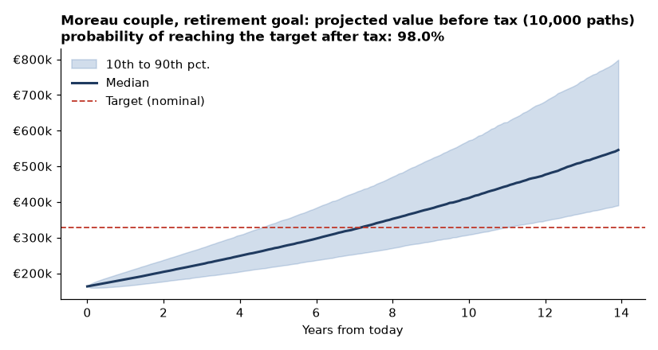
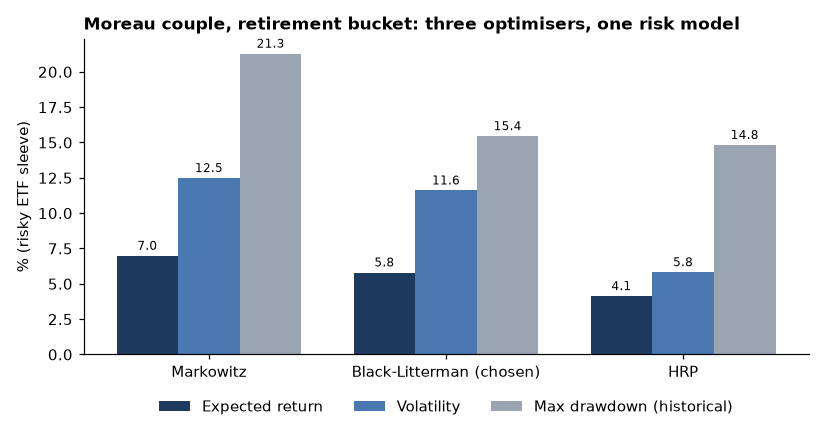
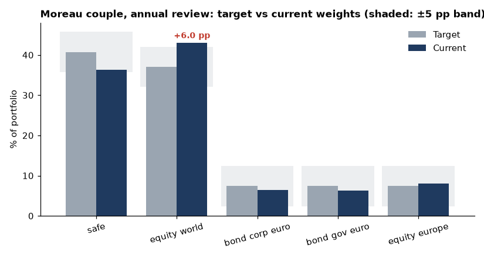
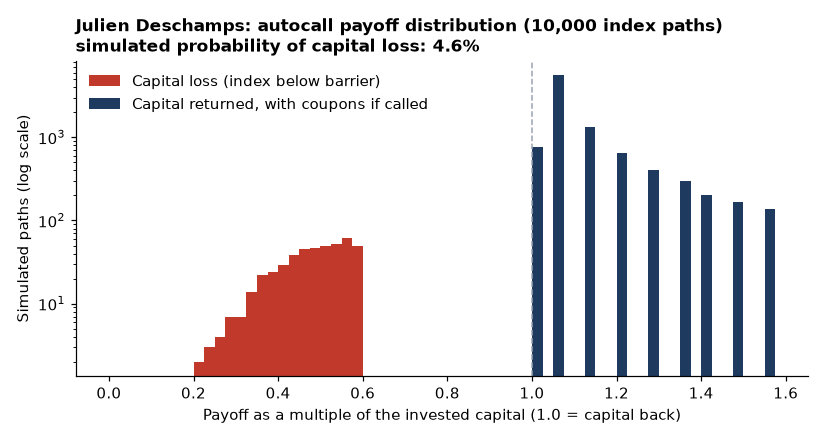
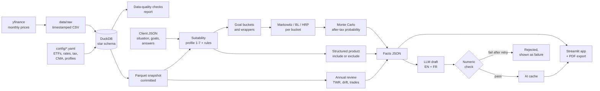

# Goal-Based Wealth Advisor

[](https://github.com/dmp009/goal-based-wealth-advisor/actions/workflows/ci.yml)


**Live demo:** coming soon (Streamlit Community Cloud)

A decision-support tool for a wealth advisor (*conseiller en gestion de patrimoine*) at a
French retail or private bank. It turns a client's situation, goals and MiFID II-style
questionnaire into a documented, goal-based proposal across French wrappers (Livret A, PEA,
assurance-vie, CTO), runs the annual review of an existing portfolio, and drafts the advisor
summary and the client letter in English and French (on demand, with an Anthropic API key).
A deterministic engine computes every number; an LLM writes the text, and a checker rejects
any document that contains a number the engine did not produce.

## The business problem

A bank advisor meets a client at two key moments.

1. **Onboarding.** The advisor must assess the client's knowledge, financial situation,
   objectives and risk tolerance (MiFID II suitability), keep an emergency fund, choose the
   right wrapper for each euro (Livret A, PEA, assurance-vie or CTO, each with its own tax
   rules and caps), build a portfolio, and decide whether a structured product is suitable.
   Then they must explain all of it in a letter that compliance can sign off.
2. **The annual review.** A year or more later, the advisor checks performance, measures how far
   the portfolio has drifted from its target, re-runs the questionnaire, updates the chances of
   reaching each goal and proposes rebalancing trades, without triggering avoidable tax.

In practice this means spreadsheets, copied numbers and letters written by hand, so it is slow
and hard to audit. This project automates the calculations and the paperwork and keeps the
advisor in charge: every rule that shaped the proposal is written out as text, every
exclusion has a reason, and every AI-drafted document is checked against the engine's numbers
before the advisor sees it.

## What the advisor sees

The Streamlit app has five pages: **New client**, **Annual review**, **Product universe**,
**Data quality** and **About**. The charts below are re-plotted with matplotlib from the same
engine outputs the app uses (`make figures`). They are not app screenshots.

| Goal probability: Monte Carlo fan chart | Three optimisers compared on one bucket |
|---|---|
|  |  |
| **Annual review: drift against the ±5 pp band** | **Structured product: simulated autocall payoff** |
|  |  |

## Sample clients and results

Four fictional clients cover the range a bank advisor meets: a young professional saving for
a flat, a couple preparing retirement, a business owner with experience of structured products
and a retiree who needs income and capital preservation. Probabilities are the share of 10,000
simulated paths in which the goal is reached **after tax**, with the target inflated at 2 % a
year.

<!-- RESULTS:START -->
*Generated by `make readme` from the engine on the committed snapshot (last price date 2026-10-31).*

**New-client proposals**

| Client | Age, household | Risk profile | Goals: target in today's €, year, probability | Structured product |
|---|---|:-:|---|---|
| Camille Laurent | 28, single | 3 / 7 | Deposit for a first flat: €38,500, 2031, **69.6%** | **Excluded**: Structured products require profile 4 or higher (client profile 3). Structured products require a horizon of at least 8 years (client horizon 4.7 years). The client declares no knowledge of structured products. |
| Isabelle and Marc Moreau | 52, couple | 4 / 7 | Daughter's master's degree: €40,000, 2030, **50.7%**<br>Retirement top-up capital: €250,000, 2040, **98.0%**<br>Country house renovation: €30,000, 2032, **57.4%** | **Excluded**: The client declares no knowledge of structured products. |
| Julien Deschamps | 45, single | 6 / 7 | Children's studies abroad: €120,000, 2033, **64.0%**<br>Retirement capital: €1,200,000, 2046, **78.0%**<br>Holiday home: €140,000, 2038, **43.9%** | **Included**: Autocall on the Euro Stoxx 50, €93,075 in assurance-vie (simulated probability of capital loss 4.6%) |
| Monique Girard | 68, single | 2 / 7 | Home adaptation works: €25,000, 2028, **72.9%**<br>Long-term care reserve: €60,000, 2033, **100.0%**<br>Gift to grandchildren: €15,000, 2030, **40.8%** | **Excluded**: Structured products require profile 4 or higher (client profile 2). Structured products require a horizon of at least 8 years (client horizon 7.2 years). The client declares no knowledge of structured products. |

**Annual reviews** (clients with a portfolio opened 18 months earlier)

| Client | Period | Time-weighted return | Gain | Rebalancing trades | Goal probability: at proposal → now |
|---|---|--:|--:|---|---|
| Isabelle and Marc Moreau | 2025-04-30 to 2026-10-31 (18 months) | 17.4% | €25,300 | 6 (€7,071 sold, €0 est. tax) | Daughter's master's degree: 61.3% → 86.0%<br>Retirement top-up capital: 86.5% → 91.7%<br>Country house renovation: 59.6% → 54.3% |
| Julien Deschamps | 2025-04-30 to 2026-10-31 (18 months) | 29.2% | €117,787 | 0 (all classes inside the band) | Children's studies abroad: 68.9% → 87.0%<br>Retirement capital: 75.2% → 80.6%<br>Holiday home: 0.0% → 0.0% |
<!-- RESULTS:END -->

**How to read these numbers.**

- **The profile caps work as intended.** Camille's answers alone score 4.05 (profile 4), but
  her only goal is 4.7 years away, so the horizon rule caps her at 3. Monique has low loss
  capacity and no equity-ETF knowledge; both caps are recorded even though her score (2) is
  already below them, and the equity-ETF knowledge gap raises an appropriateness warning.
- **Structured products are the exception, not the default.** Only Julien meets all
  conditions (profile ≥ 4, horizon ≥ 8 years, declared knowledge); his amount is capped at
  15 % of investable assets after the emergency fund. The other three get the exact reasons.
- **Low probabilities are reported, not hidden.** Essential goals are funded first. The
  Moreaus' renovation and Julien's holiday home are aspirational and receive only the monthly
  saving left after the essential goals; Monique's gift to her grandchildren sits in a cautious
  profile-2 bucket with no monthly saving. Any goal below 50 % is flagged *at risk* in the
  facts and the letters.
- **Surplus has a documented destination.** Money left after every goal is funded up to the
  present value of its target goes to the longest-horizon bucket. That is why Monique's
  long-term care reserve reaches 100 %: it holds more than its target needs, and the advisor
  can see the rule that put it there.
- **The reviews use real prices.** The holdings of the Moreaus and of Julien are derived from
  their original proposal (April 2025) with real month-end prices and their monthly saving.
  The Moreaus' world-equity weight drifted 6.0 points above target, outside the ±5 point band,
  so the engine proposes six trades inside the PEA and the assurance-vie, where sales are not
  taxable. Julien's portfolio stayed inside the band, so no trade is proposed. His holiday home
  shows 0 % before and now: the plan made at the proposal date left it unfunded, and the review
  reports that instead of hiding it.

## How it works



1. **Suitability** (`wealthadvisor/suitability/`). A weighted questionnaire (knowledge and
   experience, financial situation, objectives and horizon, risk tolerance) gives a score from 1
   to 7. Cap rules then lower it: horizon under 3 years caps at 2, 3 to 5 years at 3, low loss
   capacity at 3, no equity-ETF knowledge at 4. Each rule that fires is stored as a sentence,
   and that list is the rationale shown to the advisor.
2. **Goal buckets and wrappers** (`wealthadvisor/wrappers/`). An emergency fund of 3 or 6
   months of expenses goes to Livret A first. Each goal then gets its own bucket, with a risk
   level capped by its horizon, funded essential goals first, then by date. Fixed rules
   decide the wrapper for each part of the bucket (Livret A for short-term safe money, PEA for
   long-term equity up to the 150,000 € cap, assurance-vie, then CTO), and each rule is logged.
3. **Portfolio construction** (`wealthadvisor/portfolio/`). Markowitz, Black-Litterman and an
   in-house HRP run on the risky sleeve of each bucket, with one shared risk model (Ledoit-Wolf
   covariance, capital-market-assumption returns), the profile's volatility cap and equity cap,
   and PEA-eligible ETFs only when the bucket uses the PEA. The advisor can switch the method
   per goal.
4. **Goal Monte Carlo** (`wealthadvisor/goals/`). 10,000 monthly paths per bucket with
   contributions, a fixed seed, and simplified 2026 French tax at the goal date.
5. **Structured products** (`wealthadvisor/structured/`). Two generic templates on the Euro
   Stoxx 50 (an 8-year autocall with a 60 % barrier and a capital-protected note), priced by
   simulation on the index.
6. **Annual review** (`wealthadvisor/review/`). Time-weighted return, drift against target,
   re-profiling, goal probabilities at the proposal date and now, and rebalancing trades
   inside each wrapper, with tax estimated on CTO sales.
7. **Outputs** (`wealthadvisor/ai/`, `wealthadvisor/outputs/`, `app/`). Facts JSON, bilingual
   AI documents, PDF export in English or French, and the Streamlit app.

Every formula and parameter is in [docs/methodology.md](docs/methodology.md).

## Suitability (MiFID II) and product rules

- **Traceable profile.** The profile, the raw score, the rules that fired and every
  applicable cap (binding or not) are part of the facts, so the rationale appears in the app,
  the PDF and the letters.
- **Product families.** Livret A and fonds en euros suit every profile. Bond ETFs are allowed
  from profile 1 and equity ETFs from profile 2. A missing declared knowledge of a family
  raises an appropriateness warning that the advisor must address.
- **Structured products** need profile 4 or higher, a horizon of at least 8 years and declared
  knowledge of structured products. The amount is capped at 15 % of investable assets after
  the emergency fund. When a product is excluded, every failing condition is listed. The
  autocall is always described as offering **conditional** protection ("capital repaid at
  maturity unless the index has fallen more than 40 %"), never as "capital protected".
- **Wrapper rules.** Only PEA-eligible ETFs go into the PEA (an unknown eligibility counts as
  not eligible). The Livret A ceiling (22,950 €) and the PEA contribution cap (150,000 €) are
  shared across buckets and across monthly flows. CTO sales are flagged as taxable in the
  review.
- **Disclaimer everywhere.** Every page, PDF and AI document carries "Educational project —
  not investment advice" (and its French version).

## AI letters with numeric verification

The LLM writes four documents (proposal advisor summary, proposal client letter, review
advisor summary, review client letter), each in English and in French. It receives only the
facts JSON built by the engine. It must answer through a forced tool call (`title`, `body`),
and the prompt forbids any figure or recommendation that is not in the facts.

The numeric checker (`wealthadvisor/ai/numbers.py`) then reads the text:

- **Fail closed.** Every run of digits in the text must be a recognised number that matches a
  fact, or appear verbatim in a text field of the facts (an ISIN, a ticker). Anything else is an
  error.
- **Typed matching.** English and French formats are normalised (`1,234.5`, `1 234,5`, `12 k€`,
  basis points, *milliers*). Percentages must match within the written precision (±0.05 point
  at one decimal). Euro amounts must match within ±1 % (minimum 1 €). Years, ages and
  durations must match exactly. Signs must agree. Words like "about" or "environ" do not loosen
  any of these rules.
- **Goal scoping.** Each goal has its own section under a heading that quotes its label. Inside
  that section, and on any line that names exactly one goal, only that goal's numbers (plus
  the client-level numbers) are accepted. This catches the most likely error: a correct number
  written under the wrong goal.
- **One retry, then hard failure.** On a mismatch the model gets the list of errors and one
  more attempt. If it still fails, the document is rejected and the errors are shown. Only
  verified documents are cached, so the app never displays an unverified one.
- **Cache keyed on content.** The cache key hashes the facts, the prompt template and version,
  the document type and the language, so any change in the engine's output invalidates it.

**Residual limits, stated plainly.** The checker verifies numbers, not meaning. A fact used
in the wrong sentence of the same scope (a client-level amount described as the wrong wrapper,
for example) passes. A goal mentioned without its label, or two goals named in one sentence,
fall back to checking against all numbers. Plain numbers without a unit can match any number
in scope, and numbers from one to ten written as words are not checked. The prompt asks for
no advice beyond the facts, but no code verifies that. This is why the advisor reviews every
document before it goes to a client.

**Current state.** The generation pipeline is implemented and tested with recorded and
adversarial LLM outputs. No AI document is committed yet: until the pipeline is run with an
API key, the app shows "Not generated yet" in the document tabs, and everything else (profile,
proposal, review, PDF) works without a key.

## Data governance

- **Sources.** Monthly adjusted closes for 14 UCITS ETFs listed on Euronext Paris (Amundi,
  BNP Paribas Easy) and the Euro Stoxx 50 index come from yfinance. Every raw response
  is saved with a UTC timestamp for lineage. Short ETF histories are back-filled from a
  longer-history ETF of the same asset class, and each back-filled row is flagged
  `is_proxy = true`. Rates and caps (Livret A, fonds en euros, PEA cap) live in
  `config/rates.yaml`, each with a source and an `as_of` date.
- **ETF metadata, verified field by field.** Each ETF in `config/etfs.yaml` lists the pages
  used to check it (justETF, pea.fr and other French PEA guides) and an `unverified_fields`
  list. Nothing is guessed: the PRIIPs risk indicator (SRI) could not be confirmed for any ETF
  and is left empty, and seven non-PEA-branded ETFs have an unknown PEA flag, which the engine
  treats as not eligible. The Product universe page shows these fields.
- **Capital market assumptions.** Expected returns approximate J.P. Morgan Asset Management's
  2026 Long-Term Capital Market Assumptions. Only part of them could be checked against the
  publication, so the file is marked `unverified: true` and lists the unconfirmed asset
  classes.
- **Data quality.** Automated checks cover month gaps within each price history, non-positive
  and stale prices, ETFs without prices, PEA holdings that are not PEA-eligible and Livret A
  balances above the ceiling. The latest run found no error and two stale-price warnings
  (four flat month-ends in 2017-2018 for two S&P 500 ETFs); the report also gives row counts
  and the proxy share per ticker: [data_quality_report.md](data_quality_report.md).
- **Documentation.** [Business requirements](docs/business_requirements.md) (stakeholders,
  user stories, KPI definitions), [data dictionary](docs/data_dictionary.md),
  [data model and lineage](docs/data_model.md), [methodology](docs/methodology.md).
- **Tests and CI.** About 270 pytest tests (no network) cover each engine module, the
  expected profile of every sample client, the numeric checker against adversarial texts,
  the PDF output and the app pages. GitHub Actions runs ruff and pytest on every push.

## Quickstart

Requires Python 3.11+. No API key and no network are needed to run the app: it reads the
committed snapshot in `data/snapshot/`.

```bash
git clone https://github.com/dmp009/goal-based-wealth-advisor.git
cd goal-based-wealth-advisor
python -m venv .venv && source .venv/bin/activate
make install    # package + dev dependencies
make app        # Streamlit app on http://localhost:8501
```

Optional steps:

```bash
python -m wealthadvisor.pipeline ingest          # refresh prices (network), quality report, snapshot
export ANTHROPIC_API_KEY=...                     # needed only for the AI documents
python -m wealthadvisor.pipeline ai --refresh    # generate, verify and cache the AI documents
```

Other targets: `make test`, `make lint`, `make readme` (refresh the results tables above) and
`make figures` (regenerate the README images).

### Deploying on Streamlit Community Cloud

Point the app at `app/Home.py`. Cloud installs `requirements.txt`, which pins every runtime
dependency to the exact version the test suite passed with, then installs the package itself.
Those pins need Python 3.12 or later: choose **Python 3.13** under *Advanced settings* when
creating the app (`runtime.txt` records the same version). To show the AI letters, generate
and commit `data/ai_cache/` first (`python -m wealthadvisor.pipeline ai --refresh` with an API
key); the app never calls the API itself.

## Project structure

```
goal-based-wealth-advisor/
├── wealthadvisor/
│   ├── data/          # yfinance ingest, DuckDB schema and upserts, quality checks, snapshot
│   ├── clients/       # client, goal and holding models; sample-client loader
│   ├── suitability/   # questionnaire scoring, cap rules, product-family checks
│   ├── wrappers/      # emergency fund, goal buckets, wrapper allocation, simplified tax
│   ├── portfolio/     # Ledoit-Wolf risk model; Markowitz, Black-Litterman, HRP
│   ├── goals/         # goal Monte Carlo
│   ├── structured/    # autocall and capital-protected note payoffs, eligibility
│   ├── review/        # annual review: derived holdings, TWR, drift, trades, goals
│   ├── ai/            # LLM client, prompts, numeric checker, document cache
│   ├── outputs/       # PDF export (EN/FR)
│   ├── proposal.py    # new-client orchestration and facts JSON
│   └── pipeline.py    # python -m wealthadvisor.pipeline ingest | ai
├── app/               # Streamlit app (Home + 5 pages) and chart builders
├── config/            # ETFs, rates, tax rules, CMA, profiles, questionnaire, structured
├── data/              # clients/ (sample JSON), snapshot/ (parquet); raw/ ignored
├── docs/              # requirements, data dictionary, data model, methodology, img/
├── scripts/           # README results table and figure generators
└── tests/             # pytest suite (no network)
```

## Limitations

- **Simplified 2026 French tax rules.** PEA, assurance-vie, CTO and Livret A rules are reduced
  to the main rates and thresholds. There is no income-tax option, no inheritance treatment,
  and the assurance-vie allowance is applied once at the goal date.
- **Fictional clients.** The four sample clients are invented to cover typical cases.
- **Capital market assumptions** are approximated from one published CMA and not fully
  verified. Probabilities depend heavily on them.
- **Rates as of the config.** The Livret A rate (1.7 %) and the fonds en euros rate (2.5 %)
  are taken from `config/rates.yaml` and applied over the whole horizon and over the whole
  review period.
- **ETF metadata gaps.** The SRI is not available for any ETF (left empty), and some PEA
  flags are unknown and treated as not eligible.
- **Normal returns.** The Monte Carlo draws normal monthly returns, which understates tail
  risk. Structured products use a lognormal index model with historical volatility.
- **Generic structured products.** The two templates are not real issuer products, and in the
  annual review they are valued at par (no mark-to-market).
- **AI documents not generated yet.** The app shows "Not generated yet" until the pipeline is
  run with an API key.
- **Deliberately underfunded goal.** Julien Deschamps' holiday home stays at 0 % in the annual
  review because the plan made at the proposal date left it unfunded; it is kept as an example
  of what the review must surface.
- **Numeric checker limits.** It checks numbers, not meaning (see above), so the advisor's
  review remains part of the process.
- **Client tables are empty in the snapshot.** The sample clients live in `data/clients/` and
  their holdings are derived at run time; the warehouse tables for clients, goals, holdings,
  proposals and AI documents are defined and tested but not populated in the committed
  snapshot.

## Disclaimer

Educational project, not investment advice. The clients are fictional, the structured
products are generic templates, and market data comes from free public sources (Yahoo
Finance) that may contain errors or gaps.

## Résumé en français

Cet outil aide un conseiller en gestion de patrimoine d'une banque française dans ses deux
rendez-vous clés : l'entrée en relation et la revue annuelle. À partir de la situation du
client, de ses objectifs et d'un questionnaire de type MiFID II, il calcule un profil de
risque de 1 à 7 justifié règle par règle, répartit l'épargne entre Livret A, PEA,
assurance-vie et compte-titres, compare trois méthodes d'allocation (Markowitz,
Black-Litterman, HRP) et estime par simulation de Monte-Carlo la probabilité d'atteindre
chaque objectif après impôt. Un produit structuré n'est proposé que s'il est adapté, sinon
l'exclusion est motivée. La revue annuelle mesure la performance, la dérive et propose des
arbitrages. Une IA rédige la synthèse et la lettre client en français et en anglais (à la
demande, avec une clé API) ; chaque chiffre est vérifié automatiquement. Projet pédagogique, sans valeur de conseil.
