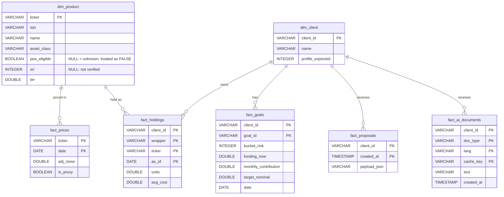
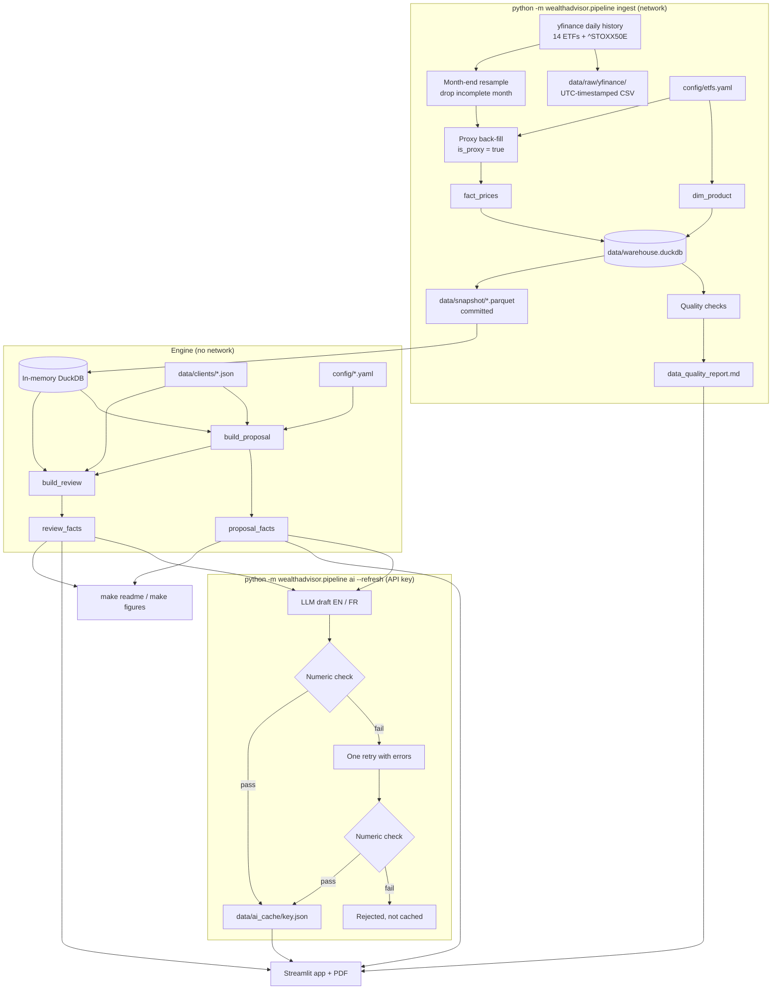

# Data model and lineage

## Star schema

Two dimensions (`dim_product`, `dim_client`) and five facts, defined in
[`wealthadvisor/data/schema.sql`](../wealthadvisor/data/schema.sql). Column definitions are in
the [data dictionary](data_dictionary.md).

Notes:

- `fact_prices` also holds `^STOXX50E`, which has no `dim_product` row (index only, used by the
  structured-product simulation). The relation is therefore not enforced as a foreign key.
- `fact_holdings.ticker` also holds non-ETF product keys (`fonds_euros`, `livret_a`,
  `structured:<id>`) that have no `dim_product` row.
- In the committed snapshot only `dim_product` and `fact_prices` are populated. Clients are read
  from `data/clients/*.json`, holdings are derived at run time and AI documents are cached as
  JSON files (see the data dictionary).

## Pipeline and lineage

Lineage guarantees:

- **Raw data**: every yfinance response is saved before any transformation, with the UTC time
  of the call in the file name.
- **Back-filled prices**: flagged row by row with `is_proxy`; the ETF's own prices are never
  modified. The proxy used for each ETF is listed in `config/etfs.yaml`.
- **Parameters**: every rate and cap carries a `source` and an `as_of` date; ETF metadata
  carries its sources and the list of unverified fields; the CMA file carries its source and an
  `unverified` flag.
- **Engine outputs**: the facts JSON contains the rules that fired (profile caps, wrapper
  rules, structured-product reasons), so each number can be traced to the rule that produced
  it.
- **AI documents**: the cache key is a hash of the facts, the prompt template and version, the
  document type and the language. A change in any of them produces a new key.
